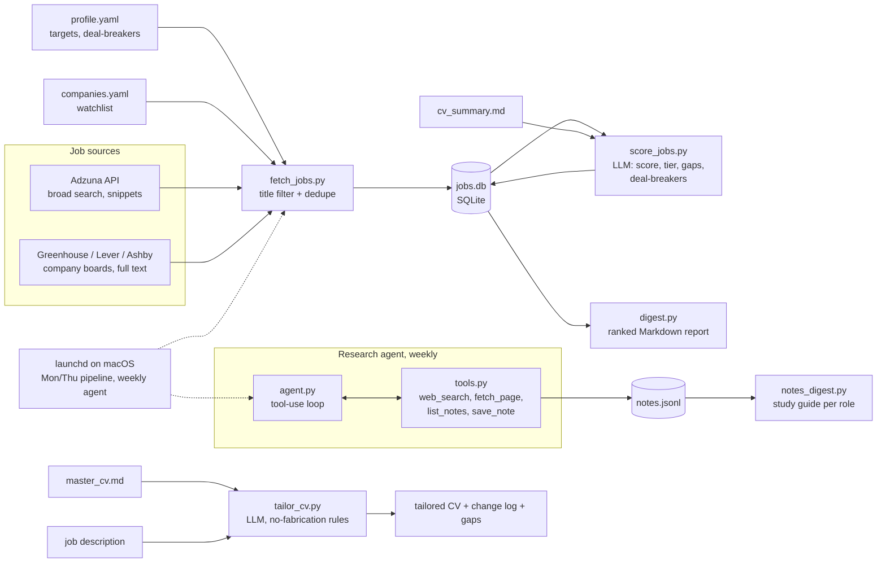

# Job Search & Interview-Prep Agent

An LLM-powered system that finds relevant job openings, scores them against my profile, researches interview material on the web, and tailors my CV for each application. Built in Python with the Claude API as a hands-on project.

It has three parts, each built in the simplest form that fits the job:

| Part | What it does | How it's built | Runs |
|---|---|---|---|
| **Job pipeline** | Fetches postings, scores fit (1–10) with gaps and deal-breakers, writes a ranked digest | Scheduled pipeline, one structured-output LLM call per job | Mon & Thu |
| **Research agent** | Searches the web for interview questions and prep material; saves only new, sourced notes and compiles them into a study guide per role | Tool-using agent with a hand-written loop | Weekly |
| **CV tailor** | Rewrites my master CV for one job without inventing anything | One LLM call with no-fabrication rules | On demand |

## Architecture



All LLM calls go through `llm.py`, which handles structured JSON output, retries on cut-off responses, and logs tokens and cost for every call.

## Design decisions

### Why only one part is an agent
- The job pipeline and CV tailor follow fixed steps and the LLM only judges or writes without deciding the next step, so code controls them and an agent isn't needed.
- Research on interview material needs to browse sites, read people’s posts, decide what’s useful, and summarize what’s new. This is open-ended, and the model has to control the loop which benefits from an agent.
- Agents cost more and are harder to test, so use one only where the model needs to decide the next step. 

### Structured output and code-enforced rules
- Every LLM result is JSON that matches a schema (score, gaps with severity, deal_breaker), so the code can rely on its fields.
- Rules that can be checked in code are checked in code: score range, duplicate notes, title filter. For example: "Don't save duplicates" is a prompt rule for the agent and also a check in save_note.

### Keeping the LLM honest
- When tailoring the CV, only use facts from master_cv.md. Never invent anything. A gaps_not_addressed field is designed so the model has a place to say "missing" instead of inventing.
- The first tailor run invented "6+ years" of experience in the summary, calculated from the dates in my CV. Fixed with explicit rules: never calculate or combine new numbers (see the [prompt log](notes/prompt_log.md)).
- The agent saves notes only from pages it actually fetched. In testing, its summaries still mixed in content from search snippets it never read, so the rule is applied to saved notes, which are what I rely on.

### Measure first, then change the prompt
- Hand-labeled 20 jobs, measured the scorer which set the baseline, then changed the prompt, measured again, and compared with the baseline.
- The eval also caught an error in my own labels: I had marked a KoBold posting as a deal-breaker from its title, but the description allowed US-based remote candidates. The scorer was right.
- The job scorer uses `claude-sonnet-5-5`. I tested the cheaper `claude-haiku-5-5` with the same eval: about 15× cheaper per job, but band agreement fell from 94–100% to 62% and it wrongly dropped a good job, so I kept Sonnet.

### Private data stays local
- Scheduling runs on my Mac with launchd instead of GitHub Actions, because the job database and CV summary are private so shouldn't end up in a public repo.
- Uses APIs and public job boards instead of scraping sites that prohibit it or are behind a login.

## Results

### Job scorer: evaluation against hand labels

20 jobs labeled by hand (17 with a score, 3 deal-breakers). The v2 → v3 prompt changes are documented in [`notes/prompt_log.md`](notes/prompt_log.md).

| Metric | v2 | v3 (two runs) | v3 on Haiku |
|---|---|---|---|
| Same score band | 82% | **94–100%** | 62% |
| Mean absolute error (points) | 0.82 | **0.24–0.41** | 0.81 |
| Deal-breakers caught | 0 of 3 | **2 of 3** | 2 of 3 |
| False alarms (good jobs dropped) | 0 | **0** | 1 |

Run it yourself: `python evals/score_eval.py --tag mytest` (add `--rescore` to re-score with the current prompt).

**Caveat:** the v3 fixes were designed using these same 20 jobs, so part of the improvement is by construction. Validation on a held-out set of new jobs is the next step.

### Cost (Claude API, from `data/usage.csv`)

| Task | Model | Cost |
|---|---|---|
| Score one job | Sonnet | ~$0.018 |
| Research agent, one role | Sonnet | ~$0.30–$1.00 in tokens (about $0.60 on average), plus web search fees |
| Tailor one CV | Opus | ~$0.19 |
| Score one job (tested, not used) | Haiku | ~$0.001 |

## Project structure

```
├── profile.yaml          # target roles, levels, locations, deal-breakers
├── companies.yaml        # company job boards to check directly
├── llm.py                # structured-output calls, retries, cost logging
├── fetch_jobs.py         # Adzuna + Greenhouse/Lever/Ashby → SQLite
├── db.py                 # SQLite storage and dedupe
├── score_jobs.py         # LLM scoring: band, tier, gaps, deal-breakers
├── digest.py             # ranked Markdown report of new jobs
├── tailor_cv.py          # CV tailoring with no-fabrication rules
├── tools.py              # agent tools: fetch_page, list_notes, save_note
├── agent.py              # research agent: hand-written tool-use loop + trace
├── notes_digest.py       # notes → Markdown study guide per role
├── evals/
│   ├── labels.csv        # hand labels for 20 jobs
│   ├── score_eval.py     # scorer vs. labels: band agreement, MAE, deal-breakers
│   └── results/          # one report per eval run + history.csv
├── scripts/              # run_pipeline.sh, run_research.sh
├── launchd/              # macOS schedules
├── research/            # notes.jsonl (agent's notes) + notes_<role>.md study guides
├── notes/prompt_log.md   # every prompt change: problem, fix, measured result
└── sample_cv.md          # fictional CV for trying the tailor
```

## Setup

Requires Python 3.10+ and an [Anthropic API key](https://console.anthropic.com). Job search via Adzuna needs a free [Adzuna API key](https://developer.adzuna.com).

```bash
git clone https://github.com/yumzh3/job_agent.git
cd job_agent
python3 -m venv .venv && source .venv/bin/activate
pip install -r requirements.txt
```

Create `.env`:

```
ANTHROPIC_API_KEY=...
ADZUNA_APP_ID=...
ADZUNA_APP_KEY=...
```

Then edit `profile.yaml` and `companies.yaml`, and create your own `master_cv.md` and `cv_summary.md` (both are git-ignored; see `sample_cv.md` for the CV format).

## Usage

```bash
python fetch_jobs.py                         # fetch new postings
python score_jobs.py 5                       # score 5 jobs (no number = all unscored)
python digest.py --preview --min-score 5     # write the digest without marking jobs as reported
python tailor_cv.py jobs/some_job.txt        # tailor the CV for one job description
python agent.py "data scientist" "Company A, Company B"   # research interview prep
python notes_digest.py                       # write research/notes_<role>.md study guides
```

The weekly research run covers the roles listed in `ROLES` in `scripts/run_research.sh` and refreshes the study guides afterwards.

To schedule: copy the files in `launchd/` to `~/Library/LaunchAgents/` (edit the paths first) and load them with `launchctl bootstrap gui/$(id -u) <file>`.

## Known limitations

- **Adzuna returns only a snippet of each description.** Scores for those jobs are marked low-confidence, and deal-breakers are caught only when the snippet states them.
- **The same job can appear twice** if found both on Adzuna and on a company board (different IDs).
- **Scores vary slightly between runs.** One borderline job moved from 7 to 9 between two identical runs.
- **The agent favors large companies** (more public interview reports) and its summaries can mention content from search snippets it didn't read; saved notes are restricted to fetched pages.
- **Company boards change.** A watchlist entry can stop working when a company moves to another job-board provider.

## Future work

- Held-out evaluation on newly labeled jobs
- Research the companies behind the top-scored jobs automatically, so interview prep follows the job search
- Fabrication checker for tailored CVs (every claim must appear in `master_cv.md`)
- Prompt caching for the scorer's repeated system prompt, profile and CV summary
- Re-score Adzuna jobs with full text pasted in by hand
- Import interview notes from login-only forums by pasting text (no automated access)

## License

MIT
